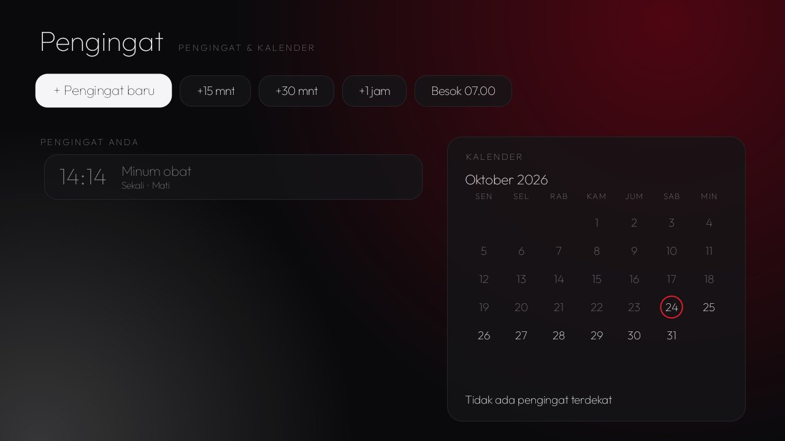

# Reminders

Reminders and a month calendar made for the remote, in English with an Indonesian translation (Pengingat). Set a
time with big digits (Up/Down change them, OK moves on), pick once, every day, weekdays or one weekday, and a label
from presets (take medicine, prayer, pick up the kids, pay bills…) or typed or dictated. Quick buttons add one in
15 or 30 minutes, an hour, or tomorrow at 07:00. When it is due, the reminder comes up full screen over whatever is
playing, with the alarm sound for up to a minute, **Snooze 10 min** and **Done**; a TV in standby is woken for it.
It declares a CleanYourTV [module card](../../docs/modules.md) ("Reminders · Alarms and calendar", red glow).



## Permissions

| Permission | Why |
|---|---|
| `USE_EXACT_ALARM` (`SCHEDULE_EXACT_ALARM` up to Android 12L) | One `AlarmManager.setAlarmClock` per reminder: exact, and it wakes the TV from standby. |
| `WAKE_LOCK` | Turns the screen on for the ten seconds the alert needs to come up. |
| `RECEIVE_BOOT_COMPLETED` | Alarms do not survive a reboot, a clock or time-zone change, or an update; they are set again then. |
| `SYSTEM_ALERT_WINDOW` | Android 10+ lets an app open its alert from the background only with this. Granted once over ADB: `appops set io.github.bayhaqy.reminders SYSTEM_ALERT_WINDOW allow`. The app draws no overlay window. |

No `INTERNET`, no background service: between reminders there are only the alarms. Reminders stay in the app's own
storage (backups are off). Nothing fires while the TV is unplugged. Font: Outfit (SIL Open Font License,
`FONT-LICENSE-OFL.txt`).

## Build and install

JDK 17+ and Android SDK 34, as for the launcher:

```bash
cd addons/reminders && ./gradlew testReleaseUnitTest lintRelease assembleRelease && cd ../..
TV_HOST=<tv ip> tools/venv/bin/python -I tools/b64push.py addons/reminders/app/build/outputs/apk/release/app-release.apk /data/local/tmp/addon.apk
TV_HOST=<tv ip> tools/venv/bin/python -I tools/tv.py 'pm install -r /data/local/tmp/addon.apk; rm -f /data/local/tmp/addon.apk; appops set io.github.bayhaqy.reminders SYSTEM_ALERT_WINDOW allow'
```

## Tested on

Changhong 43" (Skyworth `shibuya`, MediaTek), Android TV 11, firmware RTO9.240708.002: list, calendar, quick add,
the editor with the remote, and a reminder set two minutes ahead with the TV in standby.
