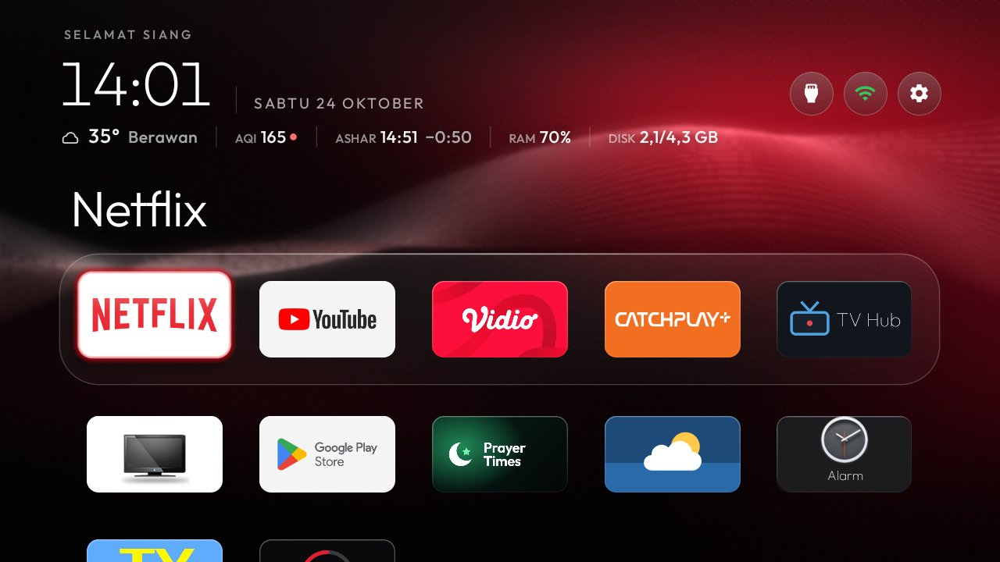
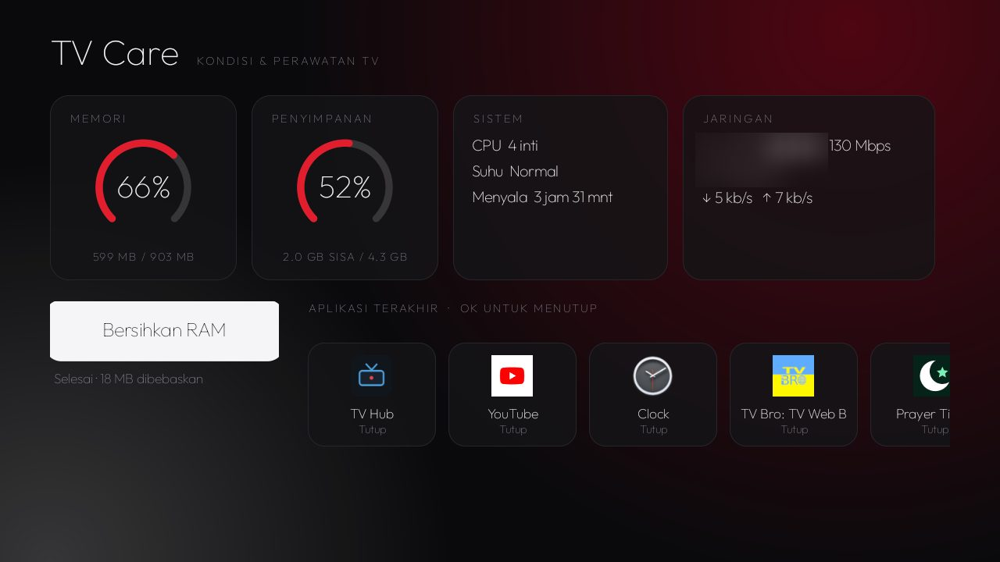
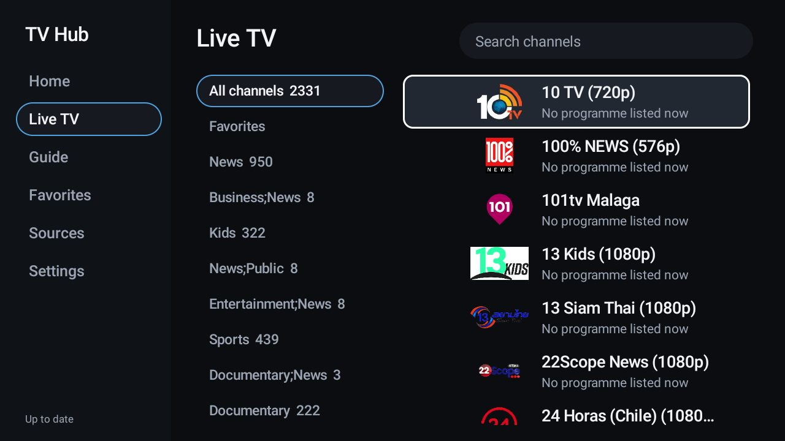
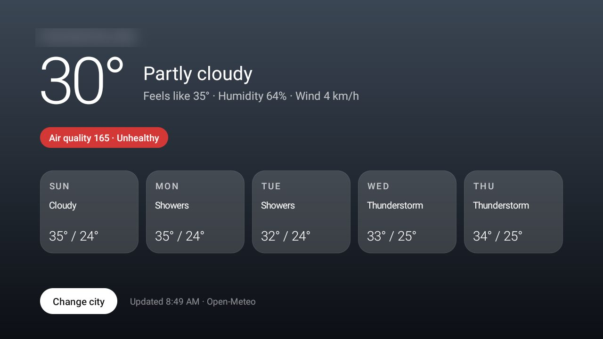
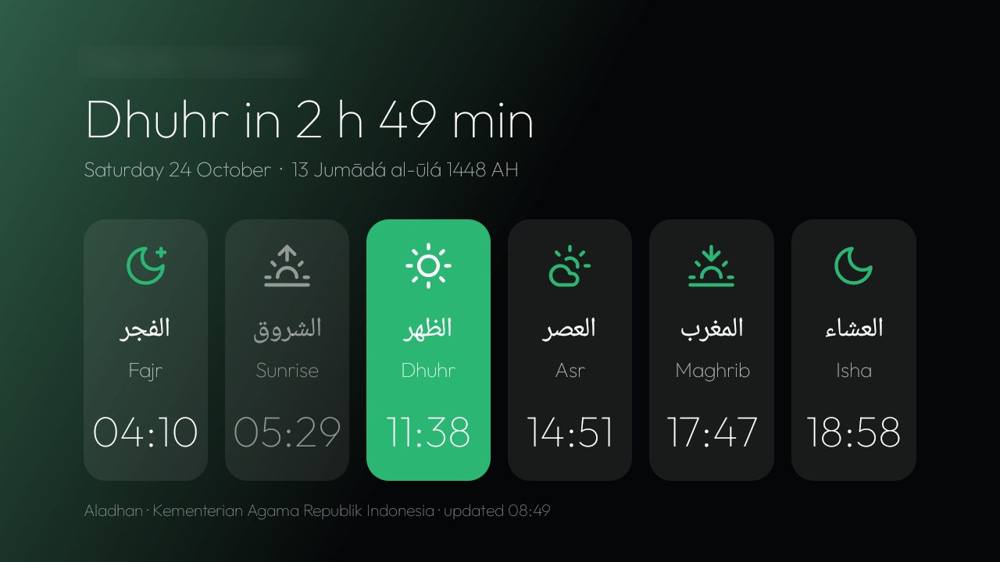
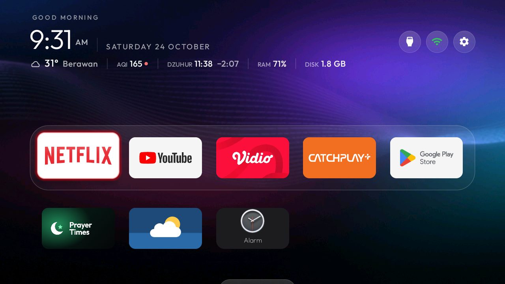
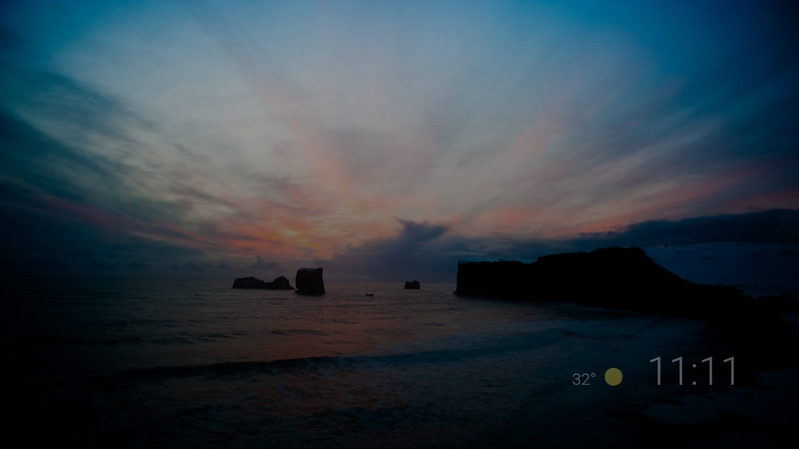

# My TV: Changhong 43" (Android TV 11)

A personal setup built on [CleanYourTV](https://github.com/Gathin23/cleanyourtv), applied and checked on a real TV.
Everything here is reversible (`restore.ps1`).

| | |
|---|---|
| TV | Changhong 43", Skyworth-built board, codename `shibuya`, MediaTek |
| Android | Android TV 11 (API 30), firmware `RTO9.240708.002` — same firmware as `examples/panasonic-th-40hs550k` |
| RAM / storage | 0.9 GB / 4.3 GB |

## Screenshots

| Before | After |
|:-:|:-:|
|  |  |
| Stock home: ads and recommendation rows | New home: glance line, glass dock, crimson wallpaper |

| | |
|:-:|:-:|
|  |  |
| TV Care: RAM, disk, network, clean RAM | TV Hub: free public IPTV playlists |
|  |  |
| Weather add-on (5 days, humidity, wind) | Prayer times add-on (KEMENAG method) |
|  |  |
| The same theme with the violet wallpaper | Ambient Mode screensaver when idle |

City names, the Wi-Fi name and the IP address are blurred.

## What was done

**Debloat** (`debloat.txt`, disabled, never uninstalled): Skyworth demo/auto-install/e-manual, Google Feedback,
MediaTek TestPQ, calendar sync, unused streaming apps, recommendation rows, and the stock launcher (after the new one
was Home). Kept: Live TV, HDMI and every `com.mediatek.*` input package, Google Assistant, Chromecast, Play Store.
User-installed games were removed with the Play Store. Storage went from 86% to 52% used.

**Launcher** (this fork's `launcher/`):
- *Glance line* under the clock (`glance_line` in `config.xml`): weather and US AQI from Open-Meteo, the next prayer
  with a countdown from Aladhan, RAM in use and free/total storage. Code: `Glance.java`, `GlanceText.java`
  (unit tested), `GlanceSpans.java`. This needs the `INTERNET` permission, which the upstream launcher does not
  have; network is used only while Home is on screen (weather every 30 minutes, prayer times once a day).
- The TV's location is **not** in the repo. Put it in `launcher/local.properties` (git-ignored); the release build
  reads it:
  ```properties
  location.latitude=-6.2
  location.longitude=106.8
  ```
  The prayer-times add-on reads the same keys plus `location.place` and `prayer.method` (20 = KEMENAG) from
  `addons/prayer-times/local.properties`.

**Theme** (`theme-crimson/`): five-column glass dock (Netflix, YouTube, Vidio, Catchplay+, Play Store), a row of
utilities below it, big app title above the dock, icon-only header buttons, app-coloured focus glow, lifted tiles.
The wallpaper is drawn by `make_wallpaper.py` (`python my-tv/make_wallpaper.py out.jpg 11 redblack`, or `violet`).
Push it with `tools\theme.ps1 -TvHost <tv ip> my-tv\theme-crimson`.

**Add-ons**:
- `addons/tv-care` (new): RAM and storage rings, CPU/thermal status/uptime, live network speed, *Clean RAM*, and the
  recently used apps with *Close*.
- `addons/weather`: 5-day forecast with humidity and wind. `addons/prayer-times`: location from `local.properties`.
- `addons/tv-hub`: built as a release with a private key; playlists from [iptv-org](https://github.com/iptv-org/iptv)
  (Indonesia, news, documentary, sports, kids), all free public channels.

**Other**: animation scales 0.5x, app caches trimmed, `bg-dexopt-job` run, alarm sound set (it was silent),
TV Bro installed as the browser (Chrome is not available for Android TV), Ambient Mode screensaver kept.

**Second pass**:
- Private DNS `dns.adguard-dns.com` (blocks ad and tracker domains; not YouTube ads). Undo in `restore.ps1`.
- The TV sleeps after 10 minutes without input (`sleep_timeout` 600000): the screensaver starts at 5, the TV goes
  to standby 5 minutes later. Playing video keeps it on.
- System language Indonesian, so the launcher greets in Indonesian and uses a 24-hour clock.
- `RUN_ANY_IN_BACKGROUND` off for Vidio, Catchplay+, TV Bro and TV Hub: they work normally when open.
- Apps and firmware checked: all up to date (Play Store, system update).
- TV Hub reads one curated playlist, `iptv/pilihan.m3u`, made by `iptv/make_playlist.py` from the public
  [iptv-org](https://github.com/iptv-org/iptv) database. Only streams that answered when the script ran are kept;
  favourites first (numbers 1 and 50), then Indonesia by category (101-), Malaysia and Singapore (301-) and the world
  by category (401-). TV Hub source: `https://raw.githubusercontent.com/bayhaqy/cleanyourtv/main/my-tv/iptv/pilihan.m3u`.
  Run the script again now and then and push: dead streams drop out.

**Third pass**:
- `addons/reminders` (new): remote-friendly reminders with a month calendar; a reminder set two minutes ahead woke
  the TV from standby and came up full screen. Replaces the stock Clock tile on Home.
- Launcher look: glass rims on tiles, a sheen along the dock, a 2dp focus ring, layered header pills, Outfit
  ExtraLight 60sp clock with tabular figures, sub-pixel glance text, and the wallpaper rendered at the panel's own
  1280x720 in 32-bit colour. The panel has only one display mode (1280x720), so nothing above 720p is possible.

**Fourth pass**:
- The panel's only display mode is 1280x720, and the firmware caps `wm size` overrides at 1920x1080 (2560x1440 and
  3840x2160 are clamped to it). The UI now draws at `wm size 1920x1080` / `wm density 320` and is downscaled to the
  panel: smoother edges and text, at a cost measured on Home of about 54% janky frames (p90 42 ms) against 0% (8 ms)
  at 720p. It applies to every app. Undo: `wm size reset; wm density reset` (in `restore.ps1`). The wallpaper is
  rendered at 1920x1080 to match.
- TV Hub keeps the curated `pilihan.m3u` first and adds back the five iptv-org lists (Indonesia, news, documentary,
  sports, kids), which grow with iptv-org; duplicates merge by `tvg-id`, so favourites keep their numbers and groups.
- Reminders: the calendar walks across months and years, a month-and-year picker, OK on a day filters the list, and
  one-off reminders take a date. The TV's alarm volume on the speaker was 1 of 7 and is now 5.

## Rebuild on a Windows PC with little free memory

Gradle needs its heap capped on this PC, or the daemon dies:

```bash
export GRADLE_OPTS="-Xmx64m -Dorg.gradle.jvmargs=-Xmx448m\ -XX:+UseSerialGC -Dorg.gradle.daemon=false -Dorg.gradle.workers.max=1"
TV_HOST=<tv ip> launcher/build-and-install.sh
```

## Undo

```powershell
powershell -ExecutionPolicy Bypass -File my-tv\restore.ps1 -TvHost <tv ip>
```
